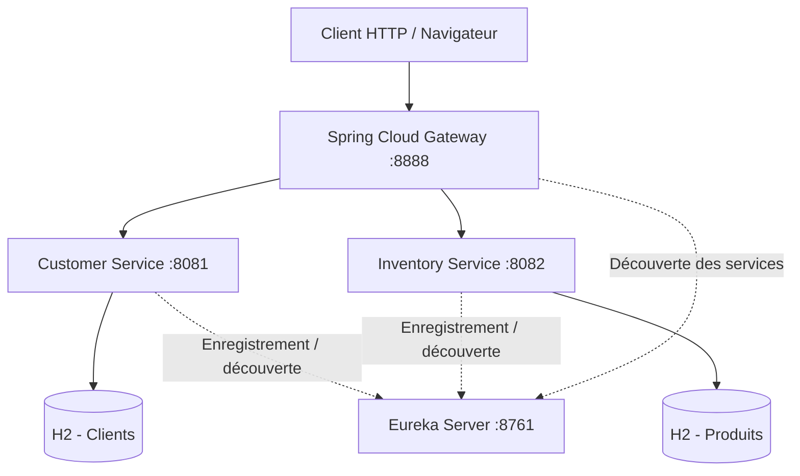

# Activité pratique n° 2 — Architecture microservices avec Spring Cloud


## 1. Présentation du projet

Cette activité pratique consiste à construire progressivement une **architecture microservices** avec **Spring Boot** et **Spring Cloud**. Contrairement à une application monolithique, les fonctions sont réparties entre plusieurs services autonomes, chacun responsable de son propre domaine métier.

Les deux premiers services implémentés sont :

- **Customer Service**, pour gérer les informations des clients.
- **Inventory Service**, pour gérer le catalogue des produits.

L'infrastructure comprend également **Eureka Discovery Server**, qui centralise la découverte des instances, et **Spring Cloud Gateway**, qui propose un point d'entrée commun pour accéder aux services.


## 2. Objectifs

- Comprendre la séparation d'une application en microservices indépendants.
- Créer et exécuter des services Spring Boot dans un projet multi-modules.
- Mettre en place la persistance des données avec **Spring Data JPA** et **H2 Database**.
- Exposer les ressources métier à travers **Spring Data REST**.
- Utiliser **Eureka Server** pour la découverte des services.
- Configurer **Spring Cloud Gateway** pour accéder aux microservices via une adresse commune.
- Vérifier le fonctionnement avec la console H2 et des requêtes HTTP dans le navigateur.

## 3. Technologies utilisées

| Technologie | Rôle |
|---|---|
| Java 21 | Langage de programmation configuré pour le projet local |
| Spring Boot | Construction et démarrage des microservices |
| Spring Data JPA | Persistance des entités Java |
| Spring Data REST | Exposition automatique des ressources REST |
| H2 Database | Base de données relationnelle légère pour les tests |
| Spring Cloud Netflix Eureka | Enregistrement et découverte des microservices |
| Spring Cloud Gateway | Point d'entrée et routage des requêtes |
| Lombok | Réduction du code répétitif (`@Data`, `@Builder`, etc.) |
| Maven / Maven Wrapper | Gestion des dépendances et compilation |
| IntelliJ IDEA | Environnement de développement |

## 4. Architecture générale



Chaque service métier possède ses propres entités, son dépôt JPA et sa base H2 de développement. Les clients peuvent interroger directement les services ou passer par la passerelle d'API.

### Services et adresses vérifiées

| Service | Port | URL testée |
|---|---:|---|
| Customer Service | `8081` | `http://localhost:8081/customers` |
| Inventory Service | `8082` | `http://localhost:8082/products` |
| Gateway | `8888` | `http://localhost:8888/customers` |
| Eureka | `8761` | `http://localhost:8761` |

> Les ports indiqués correspondent aux captures d'exécution partagées. L'enregistrement précis de chaque instance se vérifie dans la section **Instances currently registered with Eureka** du tableau de bord.

## 5. Organisation du projet

Les modules actuellement illustrés par les tests sont organisés autour des répertoires suivants :

```text
Activite-Pratique-N2-Architecture-Micro-services-avec-Spring-cloud/
├── customer-service/
│   ├── pom.xml
│   └── src/main/
│       ├── java/net/essadiki/customerservice/
│       │   ├── CustomerServiceApplication.java
│       │   ├── entities/Customer.java
│       │   └── repositories/CustomerRepository.java
│       └── resources/application.properties
├── inventory-service/
│   ├── pom.xml
│   └── src/main/...
├── discovery-service/
│   ├── pom.xml
│   └── src/main/...
└── gateway-service/
    ├── pom.xml
    └── src/main/...
```

*Cette arborescence représente l'organisation fonctionnelle attendue des modules ; les noms exacts de certains répertoires peuvent varier dans votre copie locale.*

## 6. Customer Service — gestion des clients

Le microservice **Customer Service** expose des informations clients telles que l'identifiant, le nom et l'adresse e-mail. Les données sont persistées par JPA dans une base H2 de développement.

### 6.1. Modèle métier

L'entité `Customer` contient les champs suivants :

| Attribut | Description |
|---|---|
| `id` | Identifiant du client |
| `name` | Nom du client |
| `email` | Adresse e-mail |

Le service initialise trois enregistrements de test : **Mohamed**, **imane** et **yassine**.

### 6.2. Vérification dans H2

La requête SQL ci-dessous permet de consulter la table :

```sql
SELECT * FROM CUSTOMER;
```

**Résultat observé :** trois clients sont présents dans la table `CUSTOMER`.


### 6.3. Exposition REST

L'URL suivante permet d'accéder aux clients avec Spring Data REST :

```http
GET http://localhost:8081/customers
```

La réponse utilise le format **HAL/JSON** : les clients sont inclus dans `_embedded.customers` et des liens `_links` permettent de naviguer vers les ressources individuelles.


## 7. Inventory Service — gestion des produits

Le microservice **Inventory Service** est chargé de gérer les produits disponibles. Il fournit les informations nécessaires pour identifier un produit, consulter son prix et connaître la quantité disponible.

### 7.1. Modèle métier

| Attribut | Description |
|---|---|
| `id` | Identifiant du produit |
| `name` | Désignation du produit |
| `price` | Prix |
| `quantity` | Quantité disponible |

### 7.2. Vérification dans H2

```sql
SELECT * FROM PRODUCT;
```

**Résultat observé :** trois produits sont présents dans la table `PRODUCT` : `printer`, `Phone` et `Pc`, avec leurs prix et leurs quantités respectives.


### 7.3. Exposition REST

```http
GET http://localhost:8082/products
```

Spring Data REST renvoie la collection sous `_embedded.products`, avec les propriétés des produits et les liens vers chaque ressource.


## 8. Spring Cloud Gateway — point d'entrée unique

La passerelle écoute sur le **port `8888`**. Elle permet au client d'accéder aux services en passant par une adresse commune, sans appeler directement chaque port métier.

La capture ci-dessous valide l'accès à la collection des clients via :

```http
GET http://localhost:8888/customers
```

La réponse contient les mêmes clients que le service exécuté sur `8081`. Cela montre que la route d'accès aux clients fonctionne depuis le Gateway.


Les URL `_links` visibles dans la réponse peuvent continuer à référencer `localhost:8081` : cela dépend des liens générés par le service en aval et ne signifie pas que l'appel initial n'est pas passé par le Gateway.

## 9. Eureka Discovery Server — découverte des services

**Eureka Server** constitue le registre de découverte de l'architecture. Les microservices configurés comme clients Eureka peuvent s'y enregistrer et rendre leur localisation accessible aux autres composants.

L'interface d'administration est accessible à l'adresse :

```text
http://localhost:8761
```

La capture confirme que le **tableau de bord Eureka** démarre et s'affiche. Elle montre notamment les informations générales du serveur et la section `DS Replicas`. La liste complète des instances enregistrées n'étant pas visible dans l'image fournie, leur état d'enregistrement n'est pas déduit de cette seule capture.


## 10. Démarrage et validation

### Prérequis

- **JDK 21**, conformément au `pom.xml` du module `customer-service` local.
- **IntelliJ IDEA** ou un autre IDE Java.
- **Maven Wrapper** (`mvnw.cmd`) dans les modules qui le fournissent, sinon Maven configuré sur la machine.
- Ports `8761`, `8081`, `8082` et `8888` disponibles.

### Démarrage conseillé

1. Ouvrir le projet dans IntelliJ et recharger les dépendances Maven.
2. Démarrer **Discovery Service**, puis vérifier `http://localhost:8761`.
3. Démarrer **Customer Service** et **Inventory Service**.
4. Démarrer **Gateway Service**.
5. Effectuer les vérifications HTTP et SQL présentées ci-dessus.

Pour compiler un module disposant de son Maven Wrapper, depuis son répertoire :

```powershell
.\mvnw.cmd clean compile
```

Pour lancer un module via Maven Wrapper :

```powershell
.\mvnw.cmd spring-boot:run
```

Si le projet contient des serveurs de configuration supplémentaires, démarrer ces dépendances **avant les services qui en ont besoin**, selon les propriétés du module.

### Vérifications rapides

```text
http://localhost:8761
http://localhost:8081/customers
http://localhost:8082/products
http://localhost:8888/customers
```

## 11. Fonctionnement observé

Les captures de cette activité confirment quatre points essentiels :

1. **La persistance fonctionne** : les tables H2 `CUSTOMER` et `PRODUCT` contiennent chacune trois enregistrements.
2. **Les ressources REST sont accessibles** : les collections `/customers` et `/products` retournent des données avec les liens Spring Data REST.
3. **Le routage fonctionne pour les clients** : la requête vers `localhost:8888/customers` renvoie la liste des clients.
4. **Le serveur Eureka est démarré** : son interface d'administration est accessible sur le port `8761`.

Ces résultats illustrent une première architecture distribuée où les fonctions métier sont isolées dans des services et l'accès réseau est centralisé par une passerelle.


## 13. Captures d'écran

Les captures référencées dans ce document doivent être placées dans un dossier `images/` à la racine du dépôt :

```text
images/
├── customer-h2.png
├── customer-rest.png
├── inventory-h2.png
├── inventory-rest.png
├── gateway-customers.png
└── eureka-dashboard.png
```

## Conclusion

Cette activité a permis de mettre en œuvre les premières briques d'une application distribuée avec Spring Cloud. La création de **Customer Service** et **Inventory Service** démontre la séparation des responsabilités métier, la persistance dans des bases indépendantes et l'exposition des données par REST. **Spring Cloud Gateway** fournit un accès centralisé, tandis que **Eureka** prépare la découverte dynamique des services.

Les tests réalisés dans H2 et dans le navigateur confirment le fonctionnement des principales fonctionnalités illustrées dans ce README.
